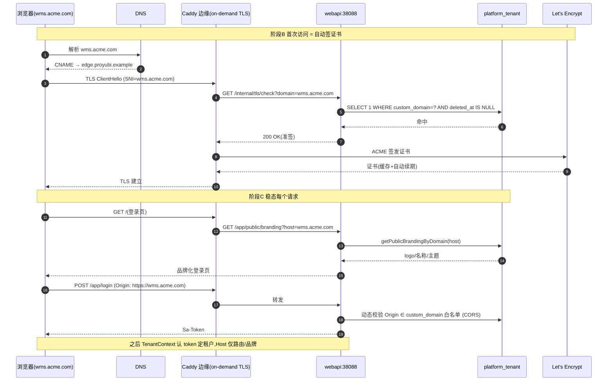

# 自定义域名（Custom Domain）设计

> 客户用自己的域名（如 `wms.acme.com`）访问 Proyubi 的 SaaS，背后仍是**一套池化多租户部署**。
> 本文给出从 DNS 到证书到品牌/CORS 的完整流程，并标注哪些组件已具备、哪些要新建。

## 1. 背景与策略

租户模型采用**池化为主 + 隔离为例外**：

| 模式 | 谁用 | 代价 |
|---|---|---|
| **池化 Pooled**（一套部署 + 一个库，按 `tenant_id` 隔离） | 默认，绝大多数客户 | 隔离必须系统级强制正确 |
| **隔离 Siloed**（单独部署/单独库） | 仅例外大客户（强合规/数据驻留、重度定制 fork 代码、性能隔离、安全审计） | N 套分别打补丁/监控/迁移，很贵 |

判据：**定制能靠「配置/能力开关」（`platform_capability` / `platform_plan` / `plan_capability.limit_json`）实现就别 silo**；要 fork 业务代码才是 silo 信号。

自定义域名是「池化」下的能力——一套部署服务所有客户域名，不为每个域名单独部署。

## 2. 核心原则（安全）

**租户身份始终来自登录后的 Sa-Token，绝不来自 Host。**
Host 头可伪造，只承担三件轻活：**路由、登录页品牌、CORS 白名单**。任何数据隔离都靠 token 里的 `tenant_id` → `TenantContext`，与域名无关。

## 3. 完整流程：三阶段

### 阶段 A · 一次性接入（客户加域名）

```
客户在 app 设置里填 wms.acme.com
   │  写入(状态=pending)
   ▼
platform_tenant.custom_domain = 'wms.acme.com'
   │  系统提示客户去配 DNS
   ▼
客户在自己 DNS 加一条：
   CNAME  wms.acme.com  →  edge.proyubi.example   (你的 Caddy 边缘)
(可选) TXT 记录校验域名归属
```

### 阶段 B · 首次 HTTPS 请求（自动签证书，零运维）

```
浏览器 https://wms.acme.com ──DNS(CNAME)──▶ Caddy 边缘
   │  Caddy：这域名我没证书 → 触发 on-demand TLS
   ▼  ★ 先问 API 准不准签 ★
Caddy GET https://api.proyubi.example/internal/tls/check?domain=wms.acme.com
   │
   ▼  API 查白名单
SELECT 1 FROM platform_tenant
 WHERE lower(custom_domain)=lower('wms.acme.com')
   AND deleted_at IS NULL          → 命中返回 200，否则 403
   │
   ▼  200 = 准
Caddy 向 Let's Encrypt 自动签发证书(ACME)并缓存，之后自动续期
```

> ⚠️ 这一步的 `check` 是命门：挡住别人拿乱域名指过来刷爆 Let's Encrypt 签发限额。

### 阶段 C · 稳态（每个请求）

```
https://wms.acme.com/...  ──▶ Caddy(证书已缓存)
   ├─ /api,/app  ─reverse_proxy→  webapi:38088
   └─ /*         ─reverse_proxy→  前端静态(wms-web)

① 登录页品牌：前端按 Host 拿品牌
    GET /app/public/branding?host=wms.acme.com
    → getPublicBrandingByDomain()  → logo/名称/主题   ✅已有
② CORS：后端校验 Origin=https://wms.acme.com
    → 动态比对 custom_domain 白名单(不是静态列表)
③ 认证/数据：用户登录 → Sa-Token → 之后每个请求带 token
    → TenantContext 认 token 定租户【不是认 Host】
```

## 4. 时序图



## 5. 实现清单

### 要新建（三块）

**① Caddy `ask` 端点（唯一全新接口）**
```
GET /internal/tls/check?domain={host}   // 仅内网可达，不暴露公网
→ 200  当 lower(custom_domain) 命中 platform_tenant(未删)
→ 403  否则
```
复用 `tenantMapper`（在 `countByCustomDomainExcluding` 旁加 `existsByCustomDomain`）。

**② CORS 改成动态白名单**
现状多为静态 origin 列表。改为：`Origin` 的 host 落 `platform_tenant.custom_domain` 查命中即放行——与 ① 同表同条件，可共用。

**③ Caddyfile（边缘，放 `deploy/`）**
```caddyfile
{
    on_demand_tls {
        ask http://webapi:38088/internal/tls/check
        interval 2m
        burst   5
    }
}

https:// {
    tls { on_demand }
    @api path /api/* /app/*
    reverse_proxy @api  webapi:38088
    reverse_proxy       wms-web:3005
}
```

### 已具备（不用动）

- `platform_tenant.custom_domain` 列 + 唯一索引 `ux_tenant_custom_domain`（天然白名单）
- `PublicTenantController.getPublicBrandingByDomain(host)`（登录页品牌）
- Sa-Token + `TenantContext`（租户解析，认 token）

## 6. 安全加固（可选）

登录成功后，断言 token 里租户的 `custom_domain` 与请求 Host 一致，防止 A 租户用户从 B 租户域名登录。

---

_关联：池化 vs 隔离的租户策略；`platform_tenant`、`platform_app_client` 的 A 类配置由 DB/迁移维护（不再用 admin 端）。_
